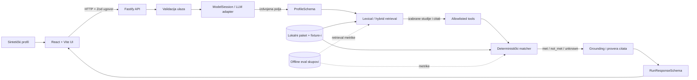

# Arhitektura

## Komponente

- `apps/web`: React + Vite interfejs; ne sadrži modelske ključeve.
- `apps/server`: Fastify API, validacija, orkestracija, memorijski `runId` store, lokalno pronalaženje, provider-neutral adapter i Gemini REST adapter; lokalni `pnpm dev` i `pnpm demo` eksplicitno biraju mock.
- `packages/shared`: Zod šeme i tipovi ugovora.
- `data/fixtures`: manifestovani sintetički zapisi T-A, T-B i T-C.
- `eval`: fiksni slučajevi, offline/fault izvršavanje i metrike zlatnog skupa.

## Tok podataka

Unos prolazi kroz Zod/tehničku validaciju pre alata. Adapter određuje nameru i može izdvojiti samo navedena polja. Retrieval vraća izvore; matcher obrađuje sintetičke fixture-e ili lokalni hash-pinned paket sa ljudski odobrenim pravilima. Pravni pregled podataka nije urađen. Server proverava citate i `RunResponse` pre slanja odgovora. `unknown` pokreće dopunu kada je moguće; odgovor menja samo traženo polje. Hipoteza je odvojena ruta koja menja samo eksplicitno izdvojene vrednosti.

Stanje postoji samo u memoriji servera i briše se njegovim restartom. Run zapisi ističu posle 30 minuta i store zadržava najviše 1.000 zapisa; uklanjanje run-a uklanja i njegovu sesiju i izvedeni cache. Direktni server podrazumeva Gemini; `pnpm dev` i `pnpm demo` biraju lokalni mock. Run-scoped sesija beleži logičke pozive, pokušaje, alate, tokene kada su dostupni i zajednički rok. Idempotency cache i zaključavanje su process-local; idempotency zapisi imaju rok od 60 sekundi, a revisions se uklanjaju kada se red operacija za run isprazni.

## Dijagram arhitekture

U DEMO režimu adapter je mock: tok se demonstrira lokalno bez Gemini poziva. `pnpm dev` koristi sintetičke fixture-e; `pnpm demo` bira `clinicaltrials-20`. Retrieval režim prikazan je u `/health` i tehničkim detaljima rezultata.

## Workflow

`received` vodi u `ready`, `awaiting_input`, `completed`, `rejected` ili `failed`. Dopuna nastavlja `awaiting_input → ready`; alat može iz `ready` preći u `running_tool`, zatim u `completed`, `awaiting_input` ili `failed`. Hipotetička izmena nakon `completed` ponavlja procenu pod istim `runId`. Nepoznat/izgubljen `runId` vraća kontrolisanu HTTP 404 grešku.

## Dozvoljeni alat

Registar sadrži `compute_egfr`, `compute_bmi`, `evaluate_criteria` i `select_next_question`; server proverava stroge ulazne/izlazne šeme i izvršava matcher samo nad odobrenim lokalnim dataset-om. Nepoznat alat i nevalidni argumenti odbijaju se pre handler-a. Tekst studije je podatak, ne instrukcija.

## Provider i dataset granica 003

ModelSession obavija svaki logički poziv rokom po run-u, ograničenom popravkom, retry pravilom i redigovanim događajima. GeminiAdapter koristi fiksni REST endpoint; prompt ne određuje provider alate ni URL-ove. Importer radi offline, a početni izlaz označava tekst kriterijuma za ručno razdvajanje. `compile:rules` objavljuje samo redove čiji ljudski review odgovara trenutnim hash-evima izvora i pravila. Aktivni paket `studies_18_approved_REVIEWED` beleži Jovaninu potvrdu deset auto pravila od 2026-11-19; ostalih 290 kriterijuma je `manual_review`. Jelenina CSV potvrda izvornog teksta vodi se odvojeno. Izvor je ClinicalTrials.gov, datum preuzimanja 2026-11-16; pravni pregled nije urađen, a uslove korišćenja treba proveriti pre javnog objavljivanja.

## RAG retrieval — Faza 2

`HybridTrialRetriever` prima `ProfileSchema` validiran profil i odobrene lokalne studije. Multi-query upit obuhvata dijagnoze/komorbiditete, poznate HbA1c, kreatinin/eGFR i BMI oblasti i lekove. Verzionsani srpsko-engleski rečnik (`sr-en-clinical-v2`) transliteriše ćirilicu i normalizuje đ/dž pre prevoda; nepoznat termin ostaje u upitu i beleži se kao `untranslated` u retrieval događaju. Sirovi profilni tekst i numeričke laboratorijske vrednosti ne ulaze u embedding payload. Ako nema upitnog aspekta, metadata dozvoljene studije se vraćaju po stabilnom ID-ju.

Korpusni dokumenti se grade odvojeno za nivo studije (naslov, stanja, sažetak) i kriterijumski odlomak. MiniSearch indeks se gradi pri inicijalizaciji, vektorski query embeddings keširaju se po modelu i SHA-256 upita, a indeks se proverava prema svežim dokumentima. Metadata state/status filteri su zasebna faza i aktiviraju se samo ako je vrednost poznata u korpusu. Leksički i vektorski rangovi po više upita se kombinuju Reciprocal Rank Fusion-om; minimalna relevantnost sprečava vraćanje najbližih nerelevantnih studija. `VectorStore` ugovor ima memorijsku i lokalnu SQLite + `sqlite-vec` implementaciju; distance se porede zaokružene na pet decimala, pa se izjednačenja deterministički rešavaju leksikografskim ID-jem u obe implementacije.

RRF pravi kandidatski skup, a zasebna faza rerangira top-N studija i odlomaka. Ako `RAG_RERANKER` nije podešen, aplikacija u LIVE režimu koristi Cohere `rerank-v5.0-fast` kada postoji `COHERE_API_KEY`, a inače (i uvek u DEMO režimu) radi bez reranker-a; deterministički reranker ostaje podrazumevan u unit testovima retriever-a. `RAG_RERANKER=cohere` ili `gemini` šalje jedan ograničen zahtev i prihvata samo strogi niz `{id, score}`. Odbijen/nevalidan odgovor ili greška poziva vraća RRF redosled. Reranker ne dobija kriterijumske presude i nema uticaj na matcher.

Ako query embedding ne uspe posle ograničenih pokušaja ili vrati nevalidan odgovor, retrieval nastavlja samo leksički i beleži `lexical_fallback`; sam request ne pada zbog embeddings transporta. `data/index/` sadrži generisane fajlove i nije deo repozitorijuma.

Retrieval bira samo studije; matcher dobija sve pregledane kriterijume izabranih studija. Odlomci retrieval-a utiču na kontekst, ne na presude. U kontekst uključeni studijski tekst ostaje nepouzdan, a postojeća serverska provera citata ostaje na snazi.

Embeddings koristi samo `text-embedding-3-small`. Pri indeksiranju šalju se javni tekstovi studija (naslov, stanja, sažetak i criterion `sourceQuote`); pri pretrazi se šalju samo deterministički upitni aspekti izvedeni iz sintetičkog validiranog profila. API ključ ostaje u serverskom okruženju. Testovi/offline evaluator koriste deterministički lažni embedder. `index-build --estimate-only` prikazuje broj tekstova/tokena bez ključa, baze ili mrežnog poziva; stvarni `index:build` nije pokrenut.

## Ograničenja i budući deployment

`RunStore`, idempotency zapisi/lockovi i API rate limiter su process-local. Run stanje se briše pri restartu; rate limit i deduplikacija se ne dele između više procesa ili serverskih instanci. Ovo je prihvatljivo za lokalni demo, ali budući viš procesni deployment zahteva zajedničko skladište run-ova/idempotency ključeva i distribuirani rate limiter, kao i definisanu politiku isteka, privatnosti i oporavka. Trenutni limiti su 1.000 run zapisa sa istekom posle 30 minuta, 1.000 idempotency ključeva sa istekom posle 60 sekundi i process-local API limit od 20 zahteva u 60 sekundi po IP adresi (konfigurišu `RATE_LIMIT_MAX`/`RATE_LIMIT_WINDOW_MS`).
