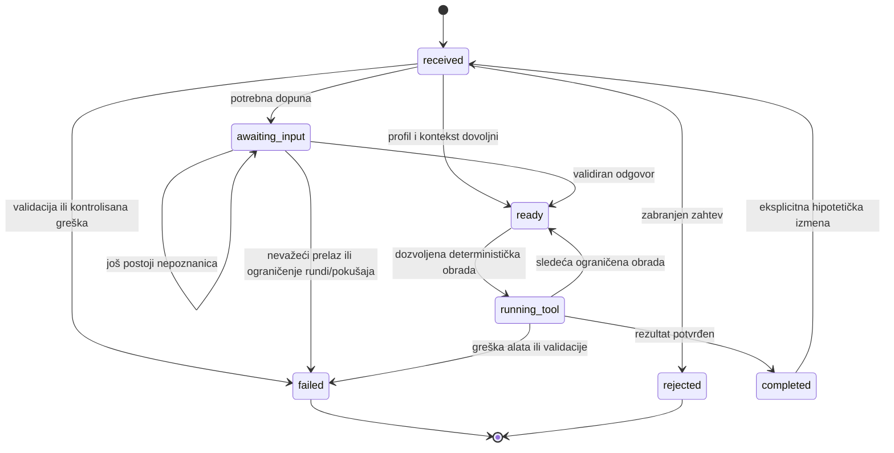

# Model podataka: Osnovna provera TrialMatch

Ovaj model opisuje podatke koji prelaze granice domena i njihove odnose. To je dizajn za implementaciju; ne menja funkcionalne zahteve u [spec.md](spec.md). Oblik će biti sproveden validacijom tokom izvršavanja na granicama.

## Entiteti

### 1. Profil

Predstavlja samo sintetički opis osobe za jedno izvršavanje. Ne pripada studiji i ne ulazi u korpus.

| Polje | Oblik i pravilo |
|---|---|
| `age` | Odsutan ili parsirana numerička starost u tehničkom opsegu unosa 0–120; nema podrazumevane vrednosti. Ovo nije medicinski referentni opseg. |
| `sex` | `male` ili `female`; odsutna ili nejasna vrednost ima status `unknown`, ne izvodi se iz imena ili dijagnoze i pokreće dopunu. eGFR se ne računa dok pol nije jasan; CKD-EPI 2021 formula i izvor potvrđeni su u projektnom brief-u. |
| `hba1c` | Odsutno ili `{ value, unit }`; tehnički opseg unosa nakon normalizacije je 3,0–20,0%; jedinica ostaje uz poreklo vrednosti. Ovo nije medicinski/laboratorijski referentni opseg. |
| `creatinine` | Odsutno ili `{ value, unit }`; tehnički opseg unosa posle konverzije je 0,1–20 mg/dL. Normalizacija se beleži kao izvedeni podatak, a ne kao zamena za izvorni unos. Konverzija je potvrđena u projektnom brief-u. |
| `height`, `weight` | Svako polje je odsutno ili sadrži vrednost i jedinicu; tehnički opsezi unosa nakon normalizacije su 50–250 cm i 2–400 kg. Ovo nisu medicinski referentni opsezi. |
| `insulin_last_3_months` | `true`, `false` ili odsutno. Odsutno nie isto što i `false`. |
| `medications[]` | Navedene terapije iz unosa; ne predstavljaju savet niti preporuku. |
| `stated_diagnoses[]` | Dijagnoze koje je unos naveo; nisu potvrđene dijagnoze sistema. |
| `ambiguities[]` | Polje i razlog nerazrešene ili protivrečne informacije. |
| `provenance` | Mapa po polju sa `origin: initial_input | answer | hypothesis` i celobrojnim `round`; početni unos je runda 0, odgovori i hipotetičke izmene nose broj odgovarajuće runde. Ne čuva se tekst profila ni izdvojeni isečak. |

Validan profil ne sme dopunjavati polja koja nisu pomenuta. Protivrečnost ili nepouzdano izdvajanje ostaje odsutno/nejasno i vodi ka `unknown` ili dopuni.

### 2. Studija

Predstavlja jedan zapis iz lokalnog skupa studija, nezavisan od profila i izvršavanja.

| Polje | Značenje |
|---|---|
| `trialId` | Stabilan ID studije iz izvora. |
| `title` | Naslov studije. |
| `conditions`, `overallStatus`, `phase`, `locations` | Metapodaci izvora za filtriranje i prikaz, kada su prisutni. |
| `eligibilityText` | Izvorni tekst kriterijuma; ne tretira se kao instrukcija sistemu. |
| `criteria[]` | Parsirana pravila sa oznakom porekla i pregleda. Matcher ne obrađuje pravilo čiji status pregleda ne dozvoljava automatsku procenu. |
| `dataVersion` | Veza ka manifestu/snimku koji je sadržao zapis. |

### 3. Kriterijum

| Polje | Značenje |
|---|---|
| `id` | Stabilni oblik `<trialId>#inc-<n>` ili `<trialId>#exc-<n>`. |
| `trialId` | Studija kojoj kriterijum pripada. |
| `kind` | `inclusion` ili `exclusion`. |
| `field` | Profilno polje na koje se pravilo odnosi. |
| `operator` | Jedan od domenom podržanih operatora (`gte`, `lte`, `between`, `eq`, `in`, `not_in`, `is_true`, `is_false`). |
| `value`, `unit` | Prag ili dozvoljene vrednosti i jedinica; moraju biti potkrepljeni izvorom. |
| `checkability` | `auto` ili `manual_review`; `manual_review` uvek daje `unknown` i oznaku da je potrebna ljudska procena. |
| `origin` | Strukturisano polje izvora ili ljudski pregledano prevedeno pravilo (`structured_field`, `compiled_reviewed`). |
| `sourceId`, `sourceQuote` | Stabilni ID i tačan odlomak iz koga pravilo potiče. |

Za kriterijum isključenja status `met` znači da se uslov isključenja ne odnosi na profil. Konačni status studije je `excluded` ako bilo koji kriterijum ima `not_met`; u suprotnom `pending` ako postoji `unknown`; inače `candidate` uz ljudsku proveru. Ove interne presude ne znače da je pacijent podoban ili odobren.

### 4. Izvorni odlomak

| Polje | Značenje |
|---|---|
| `sourceId` | Stabilni ID kriterijuma; odgovara `id` kriterijuma. |
| `trialId` | Studija izvora. |
| `kind` | Uključivanje ili isključivanje, kada je podela pouzdana. |
| `text` | Tačan tekst odlomka iz izvora, bez prevođenja ili parafraze. |
| `availableInRun` | Ne čuva se kao mutabilno polje zapisa; dostupnost se određuje skupom odlomaka koji je server predao u datom izvršavanju. |

### 5. Izvedena vrednost

Predstavlja deterministički rezultat kao što su eGFR ili BMI.

| Polje | Značenje |
|---|---|
| `name`, `value`, `unit` | Naziv, broj i jedinica. |
| `formulaName` | Formula korišćena za proračun. |
| `sourceReference` | Bibliografski izvor potvrđen u `docs/project-brief.md`; formule/pragovi koji nisu potvrđeni moraju nositi oznaku „PROVERITI prema originalnoj publikaciji“. |
| `inputFields` | Potvrđene vrednosti od kojih rezultat zavisi. Ako nedostaje bilo koji potreban ulaz, vrednost se ne izračunava. |

Brojčani rezultati i izvori su kodom određeni; model ih ne izračunava.

### 6. Pitanje za dopunu

| Polje | Značenje |
|---|---|
| `field` | Nepoznato profilno polje koje se pita. |
| `text` | Jedno konkretno pitanje na srpskom. |
| `options[]` | Ograničeni odgovori kada postoje; ponuđene vrednosti ne predstavljaju podrazumevani odgovor. |
| `trialsResolved` | Studije čiji se nepoznati kriterijumi mogu razjasniti odgovorom. |

### 7. Izvršavanje provere

| Polje | Značenje |
|---|---|
| `runId` | Jedinstveni identifikator izvršavanja; povezuje dopune i rezultate, ne otkriva identitet osobe. |
| `status` | `ok`, `needs_clarification`, `insufficient_evidence`, `rejected` ili `error`. |
| `stage` | Trenutna faza workflow-a. |
| `profile` | Validirane vrednosti i njihovo poreklo za to izvršavanje. |
| `derived[]` | Izvedene vrednosti i reference. |
| `question` | Pitanje koje čeka odgovor, ako postoji. |
| `results[]` | Studije, presude i kriterijumi sa dokazima. |
| `explanation` | Srpsko objašnjenje izvedeno iz statusa i dozvoljenih izvora. |
| `reason`, `error` | Razlog nepotpunog ishoda ili kategorija greške, poruka i mogućnost ponovnog pokušaja. |
| `meta` | Model, verzije prompta/šeme/podataka, trajanje, broj poziva i tokeni ako ih pružalac vraća. |
| `availableSourceIds` | Serverski skup ID-jeva koji su stvarno prosleđeni modelu za ovo izvršavanje; koristi se za proveru citata, nikada kao autoritet modela. |
| `attemptCounts` | Brojači naplativih modelskih poziva (najviše 4), poziva alata (najviše 10), model mrežnih ponovnih pokušaja (do 2 dodatna za timeout/429/5xx, ne ulaze u model-call limit), ukupnog trajanja (najviše 60 s) i rundi pitanja (najviše 5). Jedna runda je jedan validno oblikovan odgovor na trenutno pitanje, uključujući dvosmislen odgovor; hipoteza se ne broji, ali dopuna nakon nje se broji. Ako je posle pete runde potrebno novo pitanje, izvršavanje završava kontrolisanom greškom `question_round_limit`. Jedna popravka nevalidnog strukturisanog izlaza računa se kao model poziv; nevalidan izlaz nema mrežni retry. Broj naplativih poziva i broj mrežnih pokušaja beleže se odvojeno. |

Izvršavanja su izolovana i drže se u memoriji; restart servera ih uklanja. Tačno trajanje čuvanja unutar živog procesa nije navedeno. Svaki zahtev i nastavak podleže limitima iz `research.md`; prekoračenje ukupnih 60 sekundi vodi u `error`.

### 8. Rezultat studije i kriterijuma

- **Rezultat studije** povezuje `trialId`, naslov, internu presudu i kriterijume. Prikazani redosled je: presuda (`candidate`, `pending`, `excluded`), zatim opadajući udeo kriterijuma `met`, pa NCT ID normalizovan na velika slova i sortiran rastuće leksikografski. Ovo nije procena podobnosti; status svakog kriterijuma ostaje zaseban.
- **Rezultat kriterijuma** povezuje `criterionId`, tekst, status `met | not_met | unknown`, opaženu vrednost i izvorni ID/citat.
- Ako nema nijedne studije koja odgovara, `reason` je `no_matching_trial`; ako se iz `profileText` prepozna pitanje o činjenici studije koja nije u lokalnim izvorima, `reason` je `not_in_sources` i sistem ne daje odgovor iz opšteg znanja.

## Razdvajanje skladišta

```text
data/raw/ + manifest
        │ offline priprema
        ▼
data/trials/ ── studije + pregledana pravila + odlomci
data/fixtures/ ── sintetičke studije za stabilnu evaluaciju

RunStore (memorija, po runId)
  ├── profil (sintetički, validiran)
  ├── nepoznanice i pitanje
  ├── dostupni sourceId-jevi za ovo izvršavanje
  └── rezultat i redigovani metapodaci/trag
```

`data/trials/` ne sadrži profile, odgovore korisnika ni rezultate izvršavanja. `data/fixtures/` je odvojen od pravog snimka, tako da promene u snimku ne menjaju očekivane ishode evaluacije.

## Odnosi

- Jedan `runId` ima jedan trenutno validirani profil i može da prolazi više ograničenih rundi dopune i hipotetičkih ponovnih procena. Hipotetička izmena ažurira samo izričito navedena polja; ostala validirana polja ostaju sačuvana.
- Jedan `runId` razmatra nula ili više studija; studija u korpusu ne upućuje nazad na izvršavanja.
- Studija ima više kriterijuma; kriterijum pokazuje na tačno jedan izvorni odlomak ili je označen da dokaz nedostaje.
- Rezultat kriterijuma kopira referencu na izvor koji je bio dostupan u tom izvršavanju, a ne samo stabilni ID koji bi model mogao da izmisli.
- Izvedene vrednosti potiču od validiranih vrednosti profila. Ne postaju ulazni podatak profila bez eksplicitnog korisničkog izvora.

## Tok stanja



`completed` završava jednu procenu, ali ostaje nastavljiv samo eksplicitnom hipotetičkom izmenom u istom `runId`; prethodni trenutni rezultat se zamenjuje novim. Ovo je ograničen izuzetak za EV-06, a ne opšti nastavak završenog izvršavanja. `failed` i `rejected` su terminalni. Faza 1 ne definiše `cancel` događaj. Korisnik počinje drugi profil kontrolom „Novi unos“, čime nastaje novo izolovano izvršavanje.
